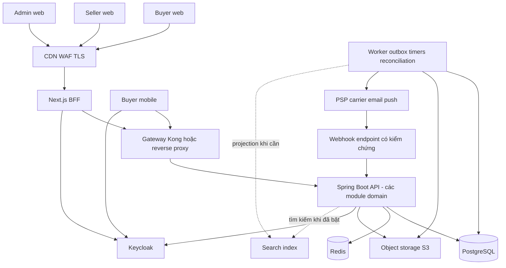

# 03. Kiến trúc và lựa chọn công nghệ

## 1. Quyết định kiến trúc cho một người trong một năm

Đề xuất **modular monolith có khả năng tách service**, không triển khai hàng chục microservice ở ngày đầu. Phân module bằng package/API nội bộ, schema và ownership; cấm module đọc/ghi tùy tiện bảng của module khác. Với chu trình order-stock-voucher, một transaction DB trong pilot giúp kiểm soát nhất quán; khi tách service phải thay bằng saga và cơ chế bù đã kiểm chứng.

Đơn vị triển khai ứng dụng ban đầu:

1. Các web Next.js: buyer, seller, admin có thể cùng monorepo và build/deploy riêng; không trộn quyền dựa trên menu.
2. `vshop-api`: Spring Boot gồm các module nghiệp vụ.
3. `vshop-worker`: cùng codebase, profile riêng, xử lý outbox, lịch hạn, đối soát, file và thông báo. Quyền và kết nối DB tách theo công việc. Có thể chạy cùng process ở local, tách process ở staging/live.
4. `vshop-mobile`: app người mua React Native/Expo, phát hành Android/iOS theo ngân sách thiết bị/tài khoản store.

Keycloak, PostgreSQL, Redis, object store, gateway và observability là hạ tầng đi kèm, không tính là các nghiệp vụ đã được tách thành microservice.

## 2. Đánh giá stack đề xuất

| Thành phần | Quyết định VShop | Lý do và lưu ý |
|---|---|---|
| Java | **Chọn** bản LTS được Spring Boot/dependency hỗ trợ; baseline Java 21 để POC | Tập trung một runtime backend; kiểm support matrix khi khởi tạo và cập nhật trước live |
| Spring Boot | **Chọn**, Security, Validation, JPA/jOOQ tùy module; Maven; Flyway | Domain và transaction ở backend; JDBC/conditional update cho tồn, khóa và tiền nếu ORM không rõ ràng |
| Spring Modulith/ArchUnit | **POC rồi chọn** | Kiểm ranh giới module, không bắt buộc thêm abstraction nếu không giúp kiểm soát |
| Next.js + TypeScript | **Chọn** App Router, SSR trang catalog, BFF/session cho web | BFF tập hợp dữ liệu và giữ session; quy tắc giá/đơn/tiền vẫn ở Java. Không cache dùng chung dữ liệu riêng tư |
| React Native + Expo | **Chọn cho app buyer** | Cùng TypeScript; chia sẻ API client/types/design tokens với web, không giả định dùng lại toàn bộ UI Next.js |
| PostgreSQL | **Bổ sung làm DB giao dịch chính** | Orders, stock, payments, journal, payout cần constraints/transactions/query đối soát rõ. JSONB đủ cho thuộc tính catalog giai đoạn đầu |
| MongoDB | **Hoãn**; cân nhắc catalog nội dung/chat khi có nhu cầu đo được | Không mặc định Mongo không có transaction: Mongo hỗ trợ multi-document transaction nhưng đòi hỏi topology phù hợp. Thêm DB làm tăng backup, migration và consistency [T03] |
| Redis | **Chọn nhỏ** cho cache/rate limit/session khi cần | Không là nguồn thật của tồn/số dư/order. Database constraint/version giữ invariant; Redis mất thì giao dịch vẫn đúng, có thể chậm hơn [T04] |
| Kong | **Có thể dùng một gateway** nếu muốn học/vận hành; POC DB-less | TLS/routing/rate limit/request ID. OIDC plugin chính thức là Enterprise; không lập kế hoạch dựa trên nó miễn phí [T05]. Phương án ngân sách nhỏ: gateway proxy + Spring Security JWT/JWKS xác minh tại backend |
| Keycloak | **Chọn** OIDC, role, MFA nội bộ, session/revoke | Auth không thay thế shop ownership/permission trong domain DB. SMS OTP cần provider/extension được bảo trì và tính chi phí [T06] |
| Elasticsearch | **P1 có điều kiện**, PostgreSQL search trước | POC tiếng Việt, không dấu, typo, facet, ranking. Index là projection có độ trễ, không dùng để quyết định giá/tồn tại checkout [T07] |
| FS bucket | **Object storage tương thích S3** + CDN | AWS S3 hoặc dịch vụ quản lý tương đương; self-host chỉ sau đánh giá vận hành. Không dùng local filesystem container làm kho file lâu dài |
| Message broker | **Outbox PostgreSQL + worker trước**, broker khi tách service | Một người tránh vận hành cả Kafka lẫn RabbitMQ. Nếu cần chọn RabbitMQ cho job/integration trước; Kafka chỉ khi có yêu cầu replay/stream thực tế |
| Payment | **Một PSP đã thẩm định** + COD | POC sandbox, partial refund, reconcile, merchant reference, webhook; lựa chọn thương mại sau, không mặc định đối tác hỗ trợ marketplace |
| Shipping | **Một carrier có hợp đồng/API** | Chuẩn adapter; báo giá, serviceability, tạo/cancel nhãn, tracking, COD, return, file đối soát |
| Test | JUnit, Testcontainers PostgreSQL, API contract, Playwright, mobile smoke, k6 | Ưu tiên concurrency/tiền/ownership; test dùng DB thật cho khóa và rollback |
| DevOps | Docker Compose, CI, registry, IaC nhỏ, secret store, backup | VM/container hoặc managed services; hoãn Kubernetes/service mesh cho đến khi có nhân sự/nhiệm vụ phù hợp |
| Observability | OpenTelemetry + log có cấu trúc; metrics/dashboard có quản lý nếu khả thi | Theo checkout/order/payment/refund/payout ID; không ghi token, PII hoặc payload nhạy cảm thô |

Đây là lựa chọn kiến trúc theo bối cảnh, không phải so sánh tốc độ tuyệt đối giữa các DB/framework. Không khóa số phiên bản từ tài liệu khảo sát: task foundation phải pin BOM/lockfile, kiểm CVE/license và chạy compatibility spike [T01].

## 3. Sơ đồ triển khai dự kiến

## 4. Ranh giới module và dữ liệu sở hữu

| Module | Dữ liệu/command sở hữu | Ra mắt và hướng tách |
|---|---|---|
| Identity/Profile | Mapping Keycloak subject, profile, address, consent | Password/token do Keycloak, không lưu bản sao |
| Merchant | Shop, onboarding, membership, bank beneficiary reference | Có version/review của hồ sơ |
| Catalog | Category, attribute, product, SKU, moderation | PostgreSQL + JSONB; search projection có thể tách sau |
| Inventory | Stock balance, reservation, movement | Tập trung một nguồn thật, khóa có thứ tự |
| Pricing/Promotion | Giá, fee schedule, voucher, quota/funding | Dùng snapshot quyết định, không dependency vòng vào order |
| Cart/Checkout | Cart, quote, checkout group, submit orchestration | Điều phối modular transaction; tách saga khi cần |
| Order | Seller order, line snapshots, command/state history | Độc lập trạng thái payment/shipment/case |
| Payment | Intent, attempts, charge, allocation, refund execution | Chỉ module này giao tiếp PSP để thu/hoàn |
| Fulfillment | Shipment, tracking, COD receivable, carrier adapter | Event raw lưu có kiểm soát; normalized state |
| Aftersales | Return case/quantity, evidence, inspection, decision/appeal | Quyết định hoàn gọi Payment, không tự post success |
| Finance | Journal, balances projection, reconciliation, settlement, payout | Bút toán bất biến, kiểm soát quyền/nguồn tiền |
| Engagement | Review, ticket, notification, preference | Chat/recommendation sau; notification tách dễ nhất |
| Governance | Policy versions, audit, abuse report, admin actions | Support xem theo phạm vi; không endpoint sửa DB tùy ý |
| Media | Upload session, asset metadata, scan state, signed access | File giấy tờ/case private; media catalog có bản public |

Cùng một PostgreSQL cluster ở pilot nhưng schema/permission có tổ chức. Sau tách service, mỗi service sở hữu DB/schema, không join trực tiếp DB service khác. Chuyển dữ liệu bằng event/outbox và API hợp đồng. Shared library chỉ gồm contract/version và tiện ích kỹ thuật, không gom toàn entity domain dùng chung.

## 5. Các hợp đồng quan trọng

API REST versioned/OpenAPI. Lỗi gồm `code`, message an toàn, correlation ID; tiền gồm currency + integer amount; thời gian lưu UTC và hiển thị Asia/Ho_Chi_Minh. Pagination ổn định; export job theo scope; API kiểm ownership ở backend. Không log bearer token hoặc toàn request KYC.

Ví dụ command: `CreateQuote`, `SubmitCheckout`, `AcceptSellerOrder`, `RequestCancellation`, `AcceptCancellation`, `CreateReturnCase`, `ApproveRefund`, `CreatePayout`. Các endpoint thay đổi tiền/đơn có idempotency key; trạng thái trả về có thể `PENDING`, UI phải xử lý bất đồng bộ.

Envelope event: `eventId`, `eventType`, `schemaVersion`, `aggregateId`, `aggregateVersion`, `occurredAt`, `correlationId`, `causationId`, payload tối thiểu. Consumer bỏ duplicate; xử lý sai thứ tự theo aggregate version; DLQ và replay có audit. Không truyền ảnh giấy tờ vào event bus.

Outbox cùng transaction domain, worker claim batch có lease/lock; crash sau gửi trước đánh dấu đã gửi có thể tạo duplicate nên downstream bắt buộc dedupe. Job hết hạn cũng dùng trạng thái DB và conditional transition, không phụ thuộc duy nhất Redis TTL.

## 6. Nhất quán và xử lý lỗi

| Tình huống | Thiết kế |
|---|---|
| Hai buyer mua SKU cuối | Conditional update/row lock + constraint; chỉ một reservation commit; retry transaction deadlock có giới hạn |
| PSP timeout | UNKNOWN, lookup qua merchant reference, reconcile; không charge lại ngay |
| Hai refund đồng thời | Khóa/atomic reserve refundable amount; cả pending lẫn completed đều trừ quota |
| Payout gửi lại | Stable payout reference; trạng thái unknown chưa nhả hold; hỏi bank/PSP trước resend |
| Redis mất dữ liệu | Cache rebuild; quota/tồn/sổ cái vẫn đúng; rate limit có fail-mode theo risk |
| Search lỗi/chậm | Fallback truy vấn DB giới hạn; không chặn xem đơn/hoàn tiền; checkout kiểm dữ liệu nguồn |
| Carrier unavailable | Retry/backoff, queue cần can thiệp; không giả tạo pickup; cảnh báo SLA |
| Worker dừng | DB giữ pending/outbox, startup resume; alert pending age và backlog |
| Tách microservice về sau | Saga rõ các bước reserve stock/quota → create order → payment; compensate khi lỗi; không distributed transaction ngầm |

PSP/carrier là hệ thống ngoài, không gọi HTTP trong một transaction giữ khóa tồn kéo dài. Dùng intent/reference + commit + async integration và recovery. Transaction ACID trong PostgreSQL không giải quyết atomicity với PSP [T02].

## 7. Xác thực và bảo mật

- Web: OIDC Authorization Code, PKCE khi phù hợp; session cookie HttpOnly/Secure/SameSite và CSRF protection. BFF giữ access/refresh token phía server; không public secret.
- Mobile: Authorization Code + PKCE qua system browser, secure storage, verified deep/app links. Không nhúng client secret; xác minh callback thanh toán qua backend.
- API: Spring Security resource server xác minh issuer, audience, expiry, signature/JWKS; test rotate signing key; service credential tối thiểu. Kong OIDC Enterprise là lựa chọn trả phí, không phải điều kiện để dùng Keycloak.
- Admin/finance: MFA, re-auth tiền/đổi beneficiary, session ngắn, audit; tài khoản hạ tầng không dùng chung account phát triển.
- Object storage: presigned upload giới hạn MIME/size/checksum; quarantine trước scan; chống path traversal; private evidence/KYC; signed GET thời hạn ngắn sau kiểm quyền. Public catalog dùng derivative đã làm sạch metadata.
- HTTPS, secret manager, encryption at rest theo hạ tầng, network rules; raw webhook chỉ lưu phần cần thiết và được che dữ liệu; rate limit OTP/login/payment/case/upload.
- Backup DB/object/version/config Keycloak theo lịch; kiểm phục hồi thực, không chỉ thấy file backup. Không lưu PAN/CVV; hosted checkout/SDK giảm dữ liệu thẻ đi qua VShop, vẫn phải xác nhận phạm vi trách nhiệm với PSP.

## 8. Chỉ tiêu phi chức năng — giả thuyết cần load test

Pilot workload tạm: 10–30 shop mời, 5.000–20.000 SKU, tối đa khoảng 100 phiên đồng thời, 5 checkout submit/giây trong bài thử. Đây là **đầu vào thử tải**, không phải dự báo nhu cầu hay cam kết hạ tầng.

Mục tiêu ban đầu: API đọc nội bộ p95 < 500ms dưới workload đã chốt; submit local commit p95 < 1,5s, đo tách latency PSP/carrier; không oversell/thu/hoàn/chi trùng. Outbox bình thường xử lý < 60 giây, cảnh báo theo age; SLO dịch vụ beta hướng tới 99,5%/tháng nhưng chỉ cam kết sau đo tải và diễn tập sự cố. Một người không bảo đảm hỗ trợ 24/7.

RPO mục tiêu 1 giờ và RTO 4 giờ cho dữ liệu giao dịch chỉ được coi đạt khi có PITR/backup thích hợp và restore drill chứng minh; nếu chưa đạt phải công bố mức phục hồi thực trước pilot. Asset backup và DB reference cần được phục hồi tương thích. Có runbook mất PSP, lệch COD, lỗi payout, xâm nhập tài khoản và rollback release.

## 9. Khi nào tách microservice hoặc thêm công nghệ

1. **Search/notification/media**: khối lượng hoặc tài nguyên chênh lệch core, có thể chạy bất đồng bộ và chấp nhận trễ; là ứng viên tách sớm.
2. **Payment/integration**: cần release/cô lập lỗi riêng, có hợp đồng sự kiện, idempotency và đối soát đã kiểm chứng; thêm vận hành và secret boundary rõ.
3. **Catalog MongoDB**: mô hình tài liệu/thao tác nội dung có lợi ích đo được vượt PostgreSQL JSONB, và đã có migration/backup/projection plan.
4. **Inventory/order**: chỉ tách khi giải pháp giữ tồn phân tán, compensation, timeout và reconcile đã qua test race/failure; không tách chỉ để có tên microservice.
5. **Kafka/Kubernetes**: cần replay/stream hoặc scheduling/scale phức tạp và đủ ngân sách/on-call; có ADR so chi phí vận hành với giải pháp hiện tại.

## 10. Nguồn kỹ thuật đã kiểm tra

| ID | Nguồn | Ý nghĩa với đề xuất |
|---|---|---|
| T01 | [Spring Boot system requirements](https://docs.spring.io/spring-boot/system-requirements.html) | Kiểm Java và bản Boot tương thích tại thời điểm pin |
| T02 | [PostgreSQL transaction](https://www.postgresql.org/docs/current/sql-begin.html) | Giao dịch DB là ranh giới nguyên tử cục bộ |
| T03 | [MongoDB production transactions](https://www.mongodb.com/docs/manual/core/transactions-production-consideration/) | Có multi-document transactions; yêu cầu deployment phù hợp |
| T04 | [Redis distributed locks](https://redis.io/docs/latest/manual/patterns/distributed-locks/) | Lock có giả định và failure mode; không dùng cache thay invariant DB |
| T05 | [Kong OpenID Connect plugin](https://developer.konghq.com/plugins/openid-connect/) | OIDC plugin chính thức ghi Enterprise only |
| T06 | [Keycloak OIDC](https://www.keycloak.org/securing-apps/oidc-layers) | Giao thức xác thực/ủy quyền ứng dụng |
| T07 | [Elasticsearch near real-time](https://www.elastic.co/guide/en/elasticsearch/reference/8.19/near-real-time.html) | Index có độ trễ hiển thị dữ liệu |
| T08 | [Next.js BFF](https://nextjs.org/docs/app/guides/backend-for-frontend) | Mô hình BFF; không chuyển toàn nghiệp vụ tiền sang frontend |

Các lựa chọn cụ thể khác trong tài liệu là quyết định thiết kế dự kiến, cần POC và kiểm compatibility/license trong foundation.
