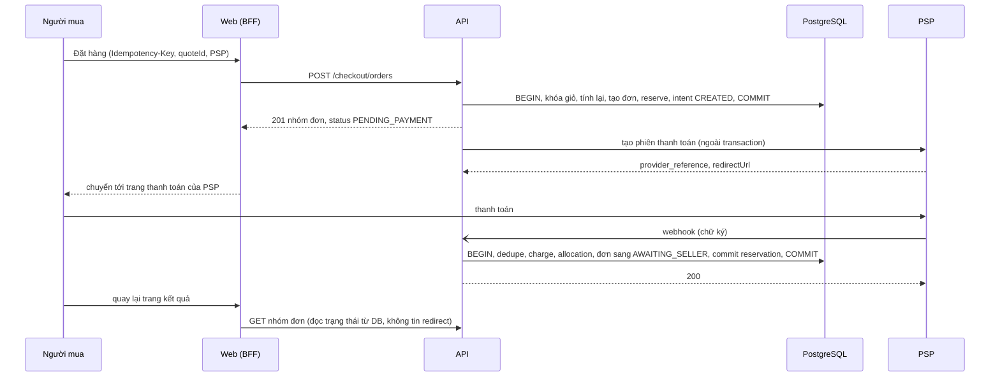
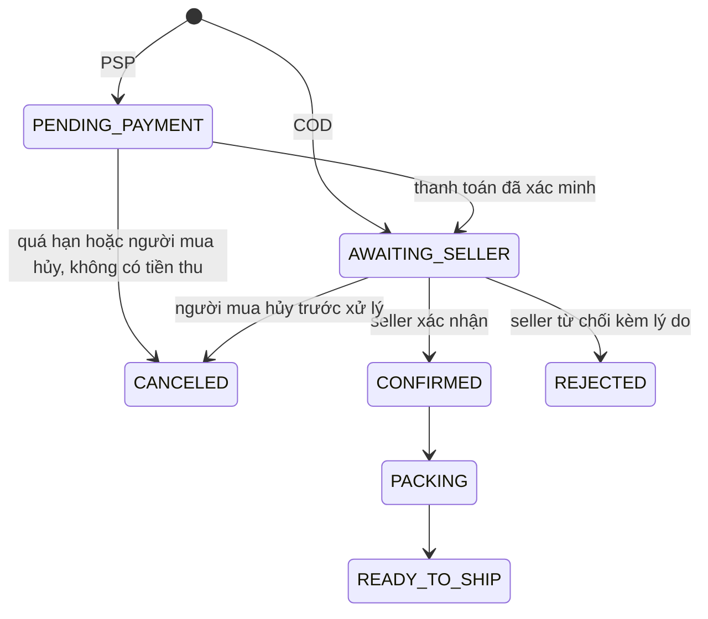

# 20. Thiết kế checkout, đơn hàng và thanh toán

Ngày: **20/11/2026**. Trạng thái: **bản thiết kế để chủ sản phẩm duyệt. Chưa có code, chưa có migration.** Mục tiêu của tài liệu là để bạn chốt các quyết định ở mục 2 mà code không thể tự quyết, và để từ đó mỗi lát cắt triển khai có đầu vào rõ ràng. Mọi quy tắc, con số và tên bảng dưới đây là **đề xuất của VShop**; không có khẳng định nào về năng lực của một PSP, hãng vận chuyển hay quy định pháp luật cụ thể (xem mục 14).

## 0. Tóm tắt

- Nền đã có: giỏ nhiều shop, báo giá có hạn gắn địa chỉ, tồn kho nguyên tử có reservation (hold/commit/release/expire), sổ địa chỉ mã hóa, phiên và MFA. **Chưa có**: đơn hàng, thanh toán, vận chuyển.
- **Có thể xây ngay, không cần PSP**: một lát cắt "đặt đơn COD từ báo giá" (mục 12, S1) gồm đơn theo từng shop, snapshot, giữ và trừ tồn, idempotency, xem đơn. Phần này chỉ phụ thuộc vài con số chính sách của bạn (D4, D5, D7).
- **Không thể xây thật khi chưa có**: thanh toán trực tuyến (cần chốt mô hình tiền D1, D2 và PSP), tạo vận đơn (cần carrier). Thiết kế dùng **port/adapter** nên phần lõi không đổi khi chọn nhà cung cấp.
- **Rào cản lớn nhất là mô hình tiền (D1): ai giữ tiền của người mua trước khi trả cho người bán.** Đây là câu hỏi pháp lý và thương mại, không phải kỹ thuật. Phụ lục A và C là danh sách câu hỏi để gửi PSP và người tư vấn pháp lý.
- Khi đọc kỹ DDL tham chiếu, mình tìm thấy **10 khoảng trống** cần bổ sung trước khi dùng nó làm migration (mục 3.2), trong đó có hai cái ảnh hưởng chính xác tới tính đúng đắn: không có liên kết giữa dòng đơn và reservation, và không có hạn thanh toán trên đơn.

## 1. Phạm vi và nền hiện có

| Thành phần                            | Trạng thái                                 | Dùng cho checkout như thế nào                                                                                           |
| ------------------------------------- | ------------------------------------------ | ----------------------------------------------------------------------------------------------------------------------- |
| Giỏ (`checkout.cart`, `cart_line`)    | Có                                         | Submit khóa dòng giỏ `FOR UPDATE`, cùng khóa với mọi thao tác sửa giỏ nên giỏ không đổi giữa chừng                      |
| Báo giá (`checkout.quote`)            | Có                                         | Đầu vào của submit: `current` (chưa hết hạn, giỏ và địa chỉ chưa đổi), snapshot giá, mỗi báo giá dùng một lần           |
| Địa chỉ (`identity.address`)          | Có                                         | Snapshot người nhận được mã hóa vào đơn bằng `PiiCipher`                                                                |
| Tồn kho (`ReservationService`)        | Có, chưa có người gọi                      | `reserve` (HELD, có hạn), `commit` (trừ `on_hand` và `reserved` cùng lúc), `release`, `expireDue`; idempotent theo khóa |
| Phiên, MFA, BFF, OpenAPI              | Có                                         | Endpoint mới đi qua cùng cơ chế, hợp đồng sinh từ mã                                                                    |
| Policy (`platform.policy_version`)    | **Chưa có** (chỉ trong DDL tham chiếu)     | Cần tối thiểu để đơn ghi chính sách đổi trả và phí ship đã dùng                                                         |
| Outbox tổng quát                      | **Chưa có** (payload hiện chỉ có `shopId`) | Cần trước khi phát sự kiện đơn và thanh toán                                                                            |
| Phí vận chuyển, voucher, thuế         | Chưa có                                    | Báo giá ghi rõ `notCalculated: [SHIPPING, DISCOUNT, TAX]`                                                               |
| Đơn, thanh toán, vận chuyển, đối soát | Chưa có                                    | Phạm vi tài liệu này (hoàn tiền, chi trả, hậu mãi chỉ để lại móc nối)                                                   |

**Ngoài phạm vi:** hoàn tiền và trả hàng (E), sổ cái và chi trả (E/F), voucher (D03–D04), app native, hóa đơn/thuế.

## 2. Quyết định cần chủ sản phẩm chốt

Mỗi dòng nói rõ **ai bị chặn** nếu chưa chốt. Cột "Khuyến nghị" là ý kiến của mình, không phải sự thật về thị trường.

| #       | Câu hỏi                                            | Lựa chọn                                                                                                                                                                                                                                | Khuyến nghị                                                                                                     | Chặn                                           |
| ------- | -------------------------------------------------- | --------------------------------------------------------------------------------------------------------------------------------------------------------------------------------------------------------------------------------------- | --------------------------------------------------------------------------------------------------------------- | ---------------------------------------------- |
| **D1**  | **Ai giữ tiền người mua trước khi trả người bán?** | (A) PSP/dịch vụ hỗ trợ marketplace (tách tiền hoặc tiểu thương nhân), VShop không giữ tiền. (B) VShop thu qua tài khoản thương nhân của chính mình rồi chi trả seller. (C) Chỉ COD ở pilot, tiền COD do carrier chuyển về theo hợp đồng | Xây theo **C**, đồng thời hỏi PSP và pháp lý để chọn A hoặc B. Không tự suy ra B hợp lệ chỉ vì code có số dư    | Toàn bộ thanh toán trực tuyến, chi trả         |
| **D2**  | Thanh toán nhiều shop                              | (a) Một lần thu cho cả nhóm đơn rồi phân bổ về từng đơn. (b) Mỗi đơn shop thanh toán riêng                                                                                                                                              | Schema theo (a) như DDL; giữ đường lui (b) nếu PSP không hỗ trợ gộp, khi đó UX đổi thành "thanh toán từng shop" | S3 (PSP)                                       |
| **D3**  | Phương thức ở pilot                                | COD trước rồi PSP, hoặc cả hai cùng lúc                                                                                                                                                                                                 | **COD trước** (S1), PSP ở S3                                                                                    | Thứ tự giao việc                               |
| **D4**  | Phí vận chuyển ở pilot                             | (a) Phí cố định mỗi đơn shop theo chính sách. (b) Miễn phí, shop hoặc sàn chịu. (c) Báo giá từ carrier                                                                                                                                  | (a) làm tạm tới khi có carrier (c). **Cần con số từ bạn**                                                       | S1, vì `payable = items − discount + shipping` |
| **D5**  | Chính sách đổi trả                                 | Số ngày được trả, ai chịu phí, ngoại lệ                                                                                                                                                                                                 | Cần số ngày và ai chịu phí; đơn lưu `return_policy_id`                                                          | S1 (cổng chính sách), E                        |
| **D6**  | Cửa sổ thanh toán và giữ hàng                      | Gợi ý trong tài liệu nghiệp vụ: 15 phút; báo giá hiện 10 phút                                                                                                                                                                           | Báo giá 10 phút; cửa sổ thanh toán 15 phút + 5 phút đệm cho reservation (mục 8)                                 | S3                                             |
| **D7**  | Hạn mức COD                                        | Tối đa mỗi đơn; số đơn COD đang mở mỗi người mua; điều kiện với tài khoản mới                                                                                                                                                           | Cần con số; mặc định đề xuất: chặn khi vượt, không tự bỏ qua                                                    | S1 (chống đặt giả giữ hàng)                    |
| **D8**  | Seller xử lý đơn                                   | Thời hạn xác nhận; quá hạn tự hủy hay chuyển hỗ trợ; seller có được từ chối                                                                                                                                                             | Quá hạn thì chuyển hàng đợi hỗ trợ, không tự hủy ngầm; từ chối có lý do                                         | S2                                             |
| **D9**  | Seller mua hàng của chính shop mình                | Cho hoặc cấm                                                                                                                                                                                                                            | **Cấm** ở pilot (tránh tự tạo đơn ảo)                                                                           | S1 (một kiểm tra)                              |
| **D10** | Phí hoa hồng và thuế                               | Mô hình tính phí cho seller                                                                                                                                                                                                             | Không cần ở checkout S1; **phải chốt trước phase E** vì cần snapshot biểu phí tại lúc phát sinh (BR24)          | Tài chính                                      |
| **D11** | Vận chuyển ở S2 khi chưa có carrier                | (a) Chờ carrier. (b) "Chế độ thủ công": seller tự nhập mã vận đơn và cập nhật trạng thái                                                                                                                                                | (b) chỉ dùng được cho thử nghiệm nội bộ vì trạng thái giao không được carrier xác nhận; không dùng để chi trả   | S2                                             |

**Điều kiện cổng chính sách (đề xuất mạnh):** checkout chỉ chạy khi có bản ghi chính sách **đã duyệt** cho phí ship (D4), đổi trả (D5), hạn mức COD (D7), cửa sổ thanh toán (D6). Bản ghi ở trạng thái nháp không dùng được. Nhờ đó con số do mình đặt tạm không âm thầm trở thành luật: chủ sản phẩm phải duyệt bằng tài khoản ADMIN có OTP, và việc duyệt được audit.

## 3. Mô hình dữ liệu

### 3.1 Từ DDL tham chiếu sang migration

DDL tham chiếu (`target-commerce.sql`) đã có `sales.checkout_group`, `seller_order`, `order_line`, `order_adjustment`, `payment.intent/attempt/charge/allocation/refund`, `fulfillment.shipment/shipment_line/shipment_event/cod_receivable`. Các ràng buộc đáng giữ nguyên: `UNIQUE(buyer, idempotency_key)` kèm `request_hash`; `UNIQUE(quote_id)` (mỗi báo giá một lần); `UNIQUE(checkout_group, shop)`; `CHECK payable = item − discount + shipping`; `CHECK gross = unit_price × quantity`; khóa ngoại ghép `(sku_id, shop_id)` giữ dòng hàng thuộc đúng shop; `merchant_reference` duy nhất; `UNIQUE(provider, provider_charge_reference)`.

Đề xuất chia migration theo lát cắt (không đưa cả 34 bảng tham chiếu chưa triển khai vào cùng lúc):

| Migration | Nội dung                                                                                               | Lát cắt |
| --------- | ------------------------------------------------------------------------------------------------------ | ------- |
| V1006     | `platform.policy_version` (tối thiểu), outbox tổng quát                                                | S0      |
| V1007     | `sales.checkout_group`, `seller_order`, `order_line`, `order_line_reservation`, `order_status_history` | S1      |
| V1008     | `payment.intent`, `attempt`, `charge`, `allocation`, `provider_event`                                  | S3      |
| V1009     | `fulfillment.*` (shipment, event, `cod_receivable`)                                                    | S2/S4   |

### 3.2 Mười khoảng trống trong DDL tham chiếu

| #   | Khoảng trống                                          | Vì sao quan trọng                                                                                                                                    | Đề xuất                                                                                                                                 |
| --- | ----------------------------------------------------- | ---------------------------------------------------------------------------------------------------------------------------------------------------- | --------------------------------------------------------------------------------------------------------------------------------------- |
| 1   | **Không có liên kết dòng đơn ↔ reservation**          | Hủy, hết hạn hoặc thanh toán thành công phải commit hay release đúng các reservation của đơn đó. `ReservationService` hiện không tra theo tham chiếu | Bảng `sales.order_line_reservation(order_line_id, reservation_id)` UNIQUE; thêm `findByReference` hoặc dùng bảng nối                    |
| 2   | **Không có hạn thanh toán trên đơn**                  | Job hết hạn cần biết đơn nào quá hạn; không thể chỉ dựa vào TTL của reservation                                                                      | `seller_order.payment_deadline` (null với COD)                                                                                          |
| 3   | Không có lịch sử trạng thái đơn                       | Quy tắc nghiệp vụ yêu cầu command và lịch sử trạng thái có actor, lý do                                                                              | `sales.order_status_history` chỉ ghi thêm: đơn, từ, sang, actor, lý do, thời điểm                                                       |
| 4   | Thiếu snapshot tên shop và ảnh                        | Đơn cũ không được đổi khi shop đổi tên (BR06)                                                                                                        | `shop_name_snapshot` trên đơn; `image_key` và `product_slug` vào snapshot dòng                                                          |
| 5   | Chỉ có snapshot người nhận mã hóa                     | Cần vùng giao (tỉnh, phường) đọc được để phân vùng và báo cáo, như báo giá đã làm                                                                    | Cột `ship_province`, `ship_ward` readable cạnh ciphertext                                                                               |
| 6   | Không có hộp thư sự kiện PSP                          | Webhook trùng và sai thứ tự cần dedupe bền                                                                                                           | `payment.provider_event(provider, provider_event_id UNIQUE, redacted_payload, received_at, processed_at)`                               |
| 7   | `return_policy_id` bắt buộc nhưng chưa có bảng policy | Không tạo đơn được                                                                                                                                   | V1006 (mục 3.1); cổng chính sách ở mục 2                                                                                                |
| 8   | Thiếu lý do và thời điểm hủy, xác nhận                | Dùng cho SLA và tra cứu                                                                                                                              | `confirmed_at`, `canceled_at`, `cancel_reason` (có thể suy ra từ lịch sử, nhưng báo cáo cần cột)                                        |
| 9   | Thiếu `warehouse_id` cho dòng đơn                     | `fulfillment.shipment.warehouse_id` NOT NULL, nhưng kho chọn lúc reserve                                                                             | Lấy từ reservation qua bảng nối (khoảng trống 1)                                                                                        |
| 10  | Số hiệu đơn chỉ là `VARCHAR UNIQUE`                   | Cần định dạng dễ đọc, không đoán được, ít trùng                                                                                                      | `VS` + ngày + 6 ký tự base32 ngẫu nhiên; trùng thì thử lại (ràng buộc UNIQUE bắt được); không dùng số tuần tự (lộ quy mô, đoán được mã) |

### 3.3 Quyết định thiết kế về dữ liệu

- Tiền luôn là `BIGINT` VND; mọi tổng ở đơn có `CHECK` ở DB (đã có trong DDL) nên phân bổ sai không thể lưu.
- Snapshot dòng đơn lấy từ **lần tính giá lại tại submit**, không từ client; kết quả phải bằng báo giá (mục 4, bước 5).
- Người nhận: JSON `{recipientName, phone, street, ward, province}` mã hóa bằng `PiiCipher`, AAD `sales.seller_order.recipient:<id>` (một địa chỉ đổi sau đó không làm đổi đơn cũ).
- Một đơn shop = một kiện ở pilot (đã nêu trong tài liệu nghiệp vụ). Schema cho phép nhiều kiện nhưng UI và API từ chối.

## 4. Luồng đặt đơn (submit)

`POST /api/v1/checkout/orders` với header `Idempotency-Key`, thân `{ quoteId, paymentMethod: "COD" | "PSP" }`. Toàn bộ phần dưới là **một transaction PostgreSQL**; không có lời gọi mạng ra ngoài bên trong nó.

1. **Idempotency.** Tính `request_hash = SHA-256(quoteId + paymentMethod)`. `INSERT ... ON CONFLICT DO NOTHING` vào `checkout_group` với `(buyer, key)`. Nếu dòng đã tồn tại: cùng hash thì trả lại kết quả cũ (HTTP 200, không tạo thêm); khác hash thì 409 `IDEMPOTENCY_CONFLICT`. Hai request đồng thời cùng khóa: cái thứ hai chờ khóa duy nhất rồi thấy dòng của cái đầu.
2. **Khóa giỏ** `FOR UPDATE` (cùng khóa với mọi thao tác sửa giỏ).
3. **Kiểm báo giá:** thuộc người gọi, `current = true` (chưa hết hạn, `cart_version` khớp, địa chỉ chưa đổi), chưa được dùng (UNIQUE). Sai thì 409 `QUOTE_NOT_CURRENT` kèm lý do.
4. **Cổng chính sách và quy tắc:** chính sách đã duyệt tồn tại (mục 2); mọi dòng còn bán; không có dòng thuộc shop của chính người mua (D9); COD trong hạn mức (D7).
5. **Tính lại giá và tồn ngay lúc này** bằng chính bộ tính của giỏ. Nếu tổng hoặc đơn giá khác báo giá: **không đặt**, trả 409 `QUOTE_CHANGED` kèm bảng chênh lệch để người mua xem và xác nhận (BR04: giá tăng cần người mua xác nhận). Không bao giờ lặng lẽ đặt với giá khác.
6. Tạo `seller_order` cho từng shop (số hiệu, snapshot người nhận, số tiền), `order_line` (snapshot tên, biến thể, ảnh, đơn giá, số lượng, `gross = unit × qty`).
7. **Giữ hàng:** với từng dòng, theo **thứ tự `sku_id` tăng dần** (tránh deadlock giữa hai checkout đồng thời), gọi `ReservationService.reserve(sku, qty, referenceId = order_line.id, key = "order:" + order_line.id, ttl)`. Thiếu hàng ở bất kỳ dòng nào làm cả transaction rollback: đơn, giữ hàng và khóa duy nhất đều biến mất, khớp quy tắc "một shop thiếu hàng rollback toàn submit". Ghi bảng nối dòng ↔ reservation.
8. **Rẽ nhánh theo phương thức:**
   - **COD:** `commit` ngay các reservation (trừ `on_hand` và `reserved` cùng lúc, BR32). Đơn vào `AWAITING_SELLER`. Tạo bản ghi phải thu COD ở bước vận chuyển (S2/S4).
   - **PSP:** đơn ở `PENDING_PAYMENT` với `payment_deadline`; reservation giữ `HELD`; tạo `payment.intent` trạng thái `CREATED` với `merchant_reference` ổn định. **Chưa gọi PSP.**
9. Xóa giỏ (các dòng đã mua) và tăng `version`; ghi lịch sử trạng thái và sự kiện outbox `OrderPlaced` trong **cùng transaction**.
10. Commit. Trả `CheckoutGroupResponse`.

**Sau commit, chỉ với PSP:** `PaymentService.startAttempt` (ngoài transaction) tạo phiên thanh toán ở PSP bằng `merchant_reference` ổn định, lưu `provider_reference`, trả `redirectUrl` hoặc dữ liệu hosted-flow cho client. Nếu tiến trình chết ngay sau commit, intent `CREATED` chưa có attempt bị **job phục hồi** nhặt lên sau N giây và tạo attempt (idempotent theo `merchant_reference`; hỏi PSP trước khi tạo mới nếu timeout).



## 5. Máy trạng thái

`SellerOrder` (phạm vi checkout; các trạng thái sau `AWAITING_SELLER` thuộc S2 và được liệt kê để chỗ nối rõ ràng):



| Chuyển                                | Ai                 | Điều kiện                                                 | Tác dụng nguyên tử                                                       |
| ------------------------------------- | ------------------ | --------------------------------------------------------- | ------------------------------------------------------------------------ |
| (tạo) → `PENDING_PAYMENT`             | Người mua          | Mục 4                                                     | Đơn, giữ hàng HELD, intent CREATED, outbox                               |
| (tạo) → `AWAITING_SELLER` (COD)       | Người mua          | Mục 4, trong hạn mức                                      | Đơn, reserve + commit, outbox                                            |
| `PENDING_PAYMENT` → `AWAITING_SELLER` | Hệ thống           | PSP đã xác minh thu đủ, khớp số tiền, tiền tệ, tham chiếu | Charge, allocation, trạng thái đơn, `commit` reservation, outbox         |
| `PENDING_PAYMENT` → `CANCELED`        | Job hoặc người mua | Không có charge; nếu PSP chưa rõ thì tra soát trước       | Trạng thái, `release` reservation (một lần), intent CANCELED             |
| `AWAITING_SELLER` → `CANCELED`        | Người mua          | Seller chưa bắt đầu xử lý                                 | Trạng thái, hoàn tồn bằng movement đảo, yêu cầu hoàn tiền nếu đã thu (E) |

Mọi chuyển trạng thái là câu `UPDATE ... WHERE status = :from AND version = :v` và ghi `order_status_history`; chạy lại không tác động hai lần (quy tắc BR13).

`PaymentIntent` và `PaymentAttempt` theo DDL: intent `CREATED → PENDING → PAID | FAILED | UNKNOWN | CANCELED`; attempt `CREATED → PENDING → SUCCEEDED | FAILED | EXPIRED | UNKNOWN`. **`UNKNOWN` là trạng thái thật, không phải lỗi**: hết thời gian chờ PSP không có nghĩa là chưa trả tiền.

## 6. Thanh toán: port và xử lý ngoại lệ

### 6.1 Port (không phụ thuộc nhà cung cấp)

```text
PaymentGateway
  createSession(merchantReference, amount, currency, returnUrl, expiresAt) -> { providerReference, redirectUrl }
  queryStatus(merchantReference)  -> { status, amount, currency, providerChargeReference?, paidAt? }
  verifyWebhook(rawBody, headers) -> { providerEventId, merchantReference, status, amount, currency, ... } | rejected
  refund(...)                      -> (phase E)
```

Chỉ mô-đun payment được gọi PSP; mô-đun khác nhận kết quả qua service nội bộ và sự kiện. Một **PSP giả lập** (cài port, mô phỏng trễ, trùng, sai thứ tự, sai số tiền, hết thời gian) được dùng cho mọi test trước khi có sandbox thật.

### 6.2 Xử lý webhook (nguyên tắc)

1. Kiểm chữ ký trên **body thô** trước mọi thứ; sai thì từ chối.
2. `INSERT` vào `provider_event` theo `(provider, provider_event_id)`; trùng thì trả 200 và dừng (trả đúng kết quả cũ).
3. Tìm attempt theo `merchant_reference`. Kiểm **số tiền, tiền tệ, thương nhân, tham chiếu** khớp intent; lệch thì ghi sự kiện, đặt intent `UNKNOWN`, **không** đánh dấu đã trả, đưa vào hàng đợi tra soát.
4. Thành công khớp: ghi `charge` (UNIQUE theo tham chiếu của PSP), `allocation` về từng đơn (số tiền bằng `payable_amount` của đơn, tổng khớp charge), chuyển đơn, `commit` reservation, outbox, tất cả một transaction. Trả 200 **sau commit**.
5. Chuyển hướng của client (`returnUrl`) **không chứng minh gì**; trang kết quả đọc trạng thái từ DB, và nếu còn `PENDING` thì hiện màn "đang xác minh" kèm làm mới, không báo thành công.
6. Webhook đến sai thứ tự không làm lùi trạng thái (so thứ tự theo thời điểm sự kiện của nhà cung cấp và trạng thái hiện tại).

### 6.3 Ngoại lệ

| Tình huống                                                                  | Xử lý                                                                                                                                         |
| --------------------------------------------------------------------------- | --------------------------------------------------------------------------------------------------------------------------------------------- |
| PSP hết thời gian khi tạo phiên                                             | Attempt `UNKNOWN`; **hỏi PSP theo `merchant_reference` trước khi tạo phiên mới**; không bao giờ tạo phiên thứ hai mù quáng                    |
| Thanh toán thành công **sau khi đơn đã hết hạn** (reservation đã `EXPIRED`) | Ghi charge, **không** hồi sinh đơn đã hủy; mở hàng đợi tra soát và hoàn tiền (BR10). Không tự reserve lại tồn vì có thể đã bán cho người khác |
| Hai lần thu cùng một đơn                                                    | Ghi cả hai charge; phần dư vào hàng đợi hoàn tiền                                                                                             |
| Thu thiếu hoặc thừa so với intent                                           | Charge được ghi; intent `UNKNOWN`; không chuyển đơn; con người xử lý                                                                          |
| Webhook đến trước khi tạo xong attempt                                      | Sự kiện được lưu, xử lý lại khi attempt xuất hiện; không mất                                                                                  |
| Job quét hết hạn gặp intent `PENDING`                                       | Gọi `queryStatus` trước; chỉ hủy khi PSP xác nhận chưa thu                                                                                    |

### 6.4 Đối soát (phase E, chỉ để móc nối)

Mỗi charge có tham chiếu PSP duy nhất; file đối soát hằng ngày của PSP so với `payment.charge`. Checkout không làm đối soát nhưng phải để lại đủ dữ liệu: `provider`, `provider_reference`, `provider_charge_reference`, số tiền, thời điểm.

## 7. Tiền: công thức và phân bổ

### 7.1 Công thức

```text
item_amount(order)   = Σ gross_amount(line)  với gross = unit_price × quantity
discount_amount      = Σ discount(line)      (0 trong S1: chưa có voucher)
shipping_amount      = phí ship theo chính sách D4 cho đơn đó
payable_amount       = item_amount − discount_amount + shipping_amount     (CHECK ở DB)
group.total_amount   = Σ payable_amount của các đơn
```

Báo giá hiện chưa có phí ship; khi có D4, **báo giá và đơn dùng cùng một hàm tính** (nếu không, tổng người mua thấy và tổng bị trừ sẽ khác nhau). Việc đó nằm trong S1: thêm phí ship vào bộ tính giá của giỏ và báo giá trước khi có đơn.

### 7.2 Phân bổ xác định (cho phí ship, voucher, hoàn tiền sau này)

Mọi khoản cần chia xuống đơn hoặc dòng dùng **cùng một thuật toán**, để kết quả luôn lặp lại được và tổng luôn đúng từng đồng:

1. Với tổng `T` và trọng số `w₁…wₙ` (số nguyên, tổng `W > 0`): `base_i = floor(T × w_i / W)`.
2. Phần dư `r = T − Σ base_i`. Chia mỗi đồng dư cho các phần tử theo **phần dư của phép chia (T × w_i mod W) giảm dần, hòa thì theo chỉ số tăng dần** (phương pháp phần dư lớn nhất, ổn định).
3. Dùng số nguyên lớn (BigInt/`long` kiểm tràn); không dùng số thực.

Vectơ thử (đã chạy bằng chương trình nhỏ, kết quả kiểm tay khớp):

| Tổng T | Trọng số         | Kết quả        | Tổng   |
| ------ | ---------------- | -------------- | ------ |
| 30.000 | 180.000; 100.000 | 19.286; 10.714 | 30.000 |
| 100    | 1; 1; 1          | 34; 33; 33     | 100    |
| 1      | 1; 1             | 1; 0           | 1      |
| 10.000 | 1; 1             | 5.000; 5.000   | 10.000 |
| 7      | 3; 3; 1          | 3; 3; 1        | 7      |

(Dòng đầu trùng ví dụ trong tài liệu nghiệp vụ, mục 7: 19.286 và 10.714.)

Ví dụ minh họa **với phí ship giả định 25.000đ/đơn do mình đặt chỉ để minh họa, không phải đề xuất giá**: một shop, 2 × 459.000 + 1 × 189.000 = 1.107.000, phải trả 1.132.000. Hai shop (918.000 và 120.000), mỗi đơn ship 25.000, voucher sàn 30.000 chia theo tiền hàng: 26.532 và 3.468, phải trả 916.468 và 141.532, tổng 1.058.000 = 918.000 + 120.000 + 50.000 − 30.000.

### 7.3 Bất biến phải có test

Tổng `allocation` của một charge bằng số tiền charge; tổng `payable` của nhóm bằng `total_amount`; tổng phân bổ đúng bằng khoản gốc; không số nào âm; kết quả không phụ thuộc thứ tự dòng đầu vào (sắp xếp theo id trước khi chia).

## 8. Hết hạn, hủy và tồn kho

- **Reservation TTL = cửa sổ thanh toán (D6) + 5 phút đệm.** Job đơn là nơi quyết định hủy; `ReservationService.expireDue` chỉ là lưới an toàn. Nhờ đệm này, tồn không bị nhả trước khi đơn kịp được hủy hay được tra soát PSP.
- **Job hết hạn đơn** (S3; hiện `expireDue` chưa có ai gọi): chọn đơn `PENDING_PAYMENT` có `payment_deadline` đã qua bằng `FOR UPDATE SKIP LOCKED`; nếu intent `PENDING`/`UNKNOWN` thì tra PSP trước; hủy khi chắc chắn chưa thu; `release` mọi reservation của đơn qua bảng nối; ghi lịch sử. Chạy lại là no-op.
- **COD:** tồn đã trừ khi đặt (BR32). Hủy trước khi giao hoàn tồn bằng movement đảo đúng một lần (E).
- `commit` không kiểm tra TTL (đã ghi ở docs/13) để đơn đã thanh toán không mất giữa hạn và lần quét; nhưng nếu reservation đã `EXPIRED` thì không `commit` được, và đó chính là nhánh "thanh toán muộn" ở mục 6.3.

## 9. API và giao diện (bản nháp)

| Thao tác                                        | Mô tả                                                                                                                                                            |
| ----------------------------------------------- | ---------------------------------------------------------------------------------------------------------------------------------------------------------------- |
| `POST /api/v1/checkout/orders`                  | Đặt đơn (mục 4); idempotent; 409 `QUOTE_NOT_CURRENT`, `QUOTE_CHANGED`, `INSUFFICIENT_STOCK`, `IDEMPOTENCY_CONFLICT`, `COD_LIMIT_EXCEEDED`, `POLICY_NOT_APPROVED` |
| `GET /api/v1/checkout/groups/{id}`              | Nhóm đơn và trạng thái thanh toán (nguồn sự thật cho trang kết quả)                                                                                              |
| `GET /api/v1/orders`, `GET /api/v1/orders/{id}` | Đơn của người mua, kèm lịch sử trạng thái                                                                                                                        |
| `POST /api/v1/checkout/groups/{id}/payments`    | Thử thanh toán lại (attempt mới) khi attempt trước thất bại; idempotent                                                                                          |
| `POST /api/v1/payments/webhooks/{provider}`     | Công khai, **chỉ** xác thực bằng chữ ký PSP; không dùng JWT                                                                                                      |
| `GET /api/v1/seller/shops/{id}/orders` ...      | S2: hộp thư đơn, xác nhận, từ chối, đóng gói                                                                                                                     |

**Trang web:** `/checkout` (tóm tắt theo shop, địa chỉ, phương thức, tổng và phần "chưa tính" nếu còn, nút đặt hàng chống bấm đúp, dùng cùng `Idempotency-Key` khi thử lại sau lỗi mạng); `/checkout/result/{groupId}` với bốn trạng thái rõ ràng (thành công, đang xác minh, thất bại có thử lại, hết hạn); `/orders` và `/orders/{id}` có timeline. Hợp đồng đi qua OpenAPI như mọi endpoint khác; BFF thêm route vào danh sách cho phép, **riêng webhook không đi qua BFF** mà vào thẳng API.

## 10. Bảo mật, quyền và chống lạm dụng

- Người mua chỉ thấy đơn của mình; seller chỉ thấy đơn của shop mình (cùng kiểu cô lập theo tài khoản đã dùng ở giỏ và địa chỉ); đơn của người khác trả 404 như không tồn tại.
- Webhook: chữ ký trên body thô, so sánh hằng thời gian, chống phát lại bằng `provider_event`, không log body thô; bí mật PSP lấy từ cấu hình, không từ DB.
- Dữ liệu cá nhân trong đơn mã hóa bằng `PiiCipher`; log và outbox không chứa số điện thoại hay địa chỉ.
- **Chống đặt đơn giả giữ hàng:** hạn mức COD (D7), giới hạn số đơn đang mở và số lần đặt mỗi người mua trong một khoảng thời gian, chặn khi vượt chứ không tự bỏ qua; đơn PSP chưa trả tự hết hạn (mục 8). Chưa có chấm điểm gian lận; đó là phase sau.
- Idempotency key gắn với tài khoản (không dùng chung giữa người dùng).

## 11. Quan sát và sự kiện

- Điều kiện tiên quyết S0: **outbox tổng quát** (loại sự kiện, loại aggregate, id, payload JSON phiên bản hóa, không chứa dữ liệu cá nhân). Hiện payload chỉ có `shopId` nên không đủ cho `OrderPlaced`, `PaymentSucceeded`…
- Sự kiện tối thiểu: `OrderPlaced`, `OrderCanceled`, `PaymentSucceeded`, `PaymentFailed`, `PaymentNeedsReview`. Consumer có dedupe (đã có `event_receipt`).
- Chỉ số cần có từ đầu: số đơn theo trạng thái, tuổi của intent `PENDING/UNKNOWN`, số reservation sắp hết hạn, độ trễ webhook, số hàng đợi tra soát. Cảnh báo theo **tuổi** của mục kẹt, không chỉ theo lỗi.

## 12. Kế hoạch giao theo lát cắt

Ước lượng là ngày công của một người, **độ tin cậy thấp đến trung bình (±40%)**, tính từ việc tách nhỏ ở đây chứ không chỉ chép từ backlog. Tổng các lát cắt dưới (khoảng 38 ngày) **lớn hơn** con số 29 ngày của phase D trong backlog gốc; mình cho rằng backlog gốc đánh giá thấp, nhất là phần phục hồi lỗi và kiểm thử đồng thời.

| Lát cắt             | Nội dung                                                                                                            | Phụ thuộc         | Ước lượng                                                      | Cổng nghiệm thu                                                   |
| ------------------- | ------------------------------------------------------------------------------------------------------------------- | ----------------- | -------------------------------------------------------------- | ----------------------------------------------------------------- |
| **S0** Nền          | Chính sách tối thiểu và cổng duyệt; outbox tổng quát; thêm phí ship vào bộ tính giá và báo giá; nối job `expireDue` | D4, D5, D6, D7    | 4                                                              | Báo giá có phí ship khớp bộ tính; chính sách nháp không dùng được |
| **S1** Đặt đơn COD  | V1007; submit nguyên tử; xem đơn người mua; trang checkout, kết quả, đơn                                            | S0, D9            | 8                                                              | Test đồng thời (mục 13) đạt; E2E mua COD hai shop                 |
| **S2** Seller xử lý | Hộp thư đơn, xác nhận, từ chối, hủy trước xử lý, chế độ vận chuyển thủ công (D11)                                   | S1, D8            | 6                                                              | Race hủy và xác nhận đúng; nhật ký đầy đủ                         |
| **S3** PSP          | Port + PSP giả lập; payment domain; webhook; job hết hạn và tra soát; UI thanh toán                                 | **D1, D2**, S1    | 10 (4 cho phần giả lập, 6 cho adapter thật sau khi có sandbox) | Ma trận lỗi (mục 13) đạt với PSP giả lập, sau đó với sandbox      |
| **S4** Carrier      | Báo giá ship, tạo vận đơn, tracking, COD phải thu, giao lỗi                                                         | Carrier được chọn | 10                                                             | Webhook trùng và sai thứ tự không lùi trạng thái                  |

Gợi ý thứ tự: **S0 → S1 ngay khi có số liệu D4, D5, D7**; trong lúc đó bạn song song gửi Phụ lục A và C để mở khóa S3. S2 và S3 có thể làm xen kẽ. Không làm S4 trước khi có hợp đồng carrier.

## 13. Kế hoạch kiểm thử

Giữ nguyên nguyên tắc của dự án: PostgreSQL thật, test đồng thời dùng transaction có commit, không dùng H2.

| Nhóm              | Kịch bản                                                                                                                                                                                                                                                                                                           |
| ----------------- | ------------------------------------------------------------------------------------------------------------------------------------------------------------------------------------------------------------------------------------------------------------------------------------------------------------------ |
| Đồng thời         | Hai người cùng mua đơn vị cuối: đúng một thắng, người thua không còn đơn dở; checkout đa shop mà một shop hết hàng thì rollback toàn bộ; **hai checkout đảo thứ tự SKU không deadlock**; cùng `Idempotency-Key` gửi 8 lần song song tạo đúng một nhóm; sửa giỏ trong lúc submit; hai submit dùng chung một báo giá |
| Idempotency       | Cùng khóa khác nội dung bị từ chối; thử lại sau khi response bị mất trả đúng kết quả cũ                                                                                                                                                                                                                            |
| Toàn vẹn tiền     | Bất biến mục 7.3 theo thuộc tính ngẫu nhiên (nhiều tổ hợp giá, số lượng, số shop); ràng buộc `CHECK` của DB từ chối số liệu sai                                                                                                                                                                                    |
| PSP (với giả lập) | Webhook trùng, sai thứ tự, sai số tiền, sai tiền tệ, chữ ký sai, đến trước attempt, đến sau khi đơn hết hạn; timeout khi tạo phiên rồi truy vấn; thu hai lần; chết tiến trình giữa commit và gọi PSP (job phục hồi)                                                                                                |
| Hết hạn           | Job chạy lặp và song song chỉ nhả tồn một lần; intent `PENDING` được tra soát trước khi hủy                                                                                                                                                                                                                        |
| Bảo mật           | Người khác không đọc được nhóm đơn hay đơn; webhook không cần JWT nhưng không chấp nhận chữ ký sai; ghi vào đơn của shop khác bị 404                                                                                                                                                                               |
| E2E               | Mua COD hai shop, thấy đơn và timeline; mạng yếu bấm đặt hai lần chỉ có một nhóm; báo giá cũ bị từ chối với lời giải thích; giá đổi giữa báo giá và đặt hiện bảng chênh lệch                                                                                                                                       |

## 14. Rủi ro và điều chưa biết

1. **Mô hình tiền (D1)** có thể buộc đổi thiết kế thanh toán (từ thu tổng sang thu theo shop, hoặc sang dịch vụ escrow). Port và schema đã được chọn để giữ thay đổi đó ở mô-đun payment, nhưng nếu nhà cung cấp quy định luồng khác hẳn thì S3 phải thiết kế lại.
2. **Mình không kiểm chứng năng lực của bất kỳ PSP hay carrier nào** (hỗ trợ tách tiền, hoàn một phần, COD, trả hàng, sandbox, phí, thời gian đối soát) và không tra cứu quy định pháp luật về trung gian thanh toán, thu hộ, giữ tiền. Phụ lục liệt kê câu hỏi để các bên trả lời; tài liệu này không thay thế tư vấn pháp lý.
3. **Quyết định D4 và D5** quyết định số tiền thật người mua phải trả và quyền lợi của họ; số mình đặt chỉ để minh họa.
4. **Chế độ vận chuyển thủ công (D11)** làm trạng thái "đã giao" do seller tự khai; chỉ nên dùng nội bộ, và đơn không được chi trả dựa vào nó.
5. **Một người vừa viết mã vừa duyệt chính sách** (D4–D7) không phải kiểm soát hai người thật; cổng duyệt chỉ bảo đảm có dấu vết và không chạy với nháp.
6. Ước lượng ở mục 12 chưa được hiệu chỉnh bằng một lát cắt thật; nên đo lại sau S1.
7. Chưa quyết nơi chạy job nền ở production (cùng tiến trình hay worker riêng); thiết kế dùng `FOR UPDATE SKIP LOCKED` nên chạy được nhiều bản song song.
8. Kiểm soát lạm dụng ở mục 10 là tối thiểu; một sàn thật cần thêm xác minh số điện thoại và chấm điểm rủi ro.

## Phụ lục A — Câu hỏi cho PSP

1. Hỗ trợ marketplace thế nào: tiểu thương nhân, tách tiền, hoặc chuyển tiền cho người bán; ai chịu trách nhiệm pháp lý với tiền của người bán?
2. Một lần thanh toán có thể gồm nhiều người bán không? Nếu không, quy trình cho giỏ nhiều shop?
3. Hoàn tiền một phần và nhiều lần trên cùng giao dịch; hạn hoàn; ai chịu phí; trạng thái trung gian.
4. Webhook: cơ chế chữ ký, thời gian thử lại, đảm bảo thứ tự, trùng; API truy vấn theo tham chiếu thương nhân; thời gian hiệu lực của phiên.
5. Sandbox: có đủ mọi trạng thái lỗi, trùng, trễ không? Có mô phỏng timeout không?
6. Đối soát: định dạng, tần suất, độ trễ; chargeback và tranh chấp.
7. Giới hạn số tiền, hạn mức, phí, thời gian ký hợp đồng, yêu cầu hồ sơ pháp lý.

## Phụ lục B — Câu hỏi cho hãng vận chuyển

1. Báo giá và kiểm tra vùng phục vụ theo địa chỉ; dữ liệu đơn vị hành chính nào được dùng (quan trọng vì tên tỉnh, phường đã thay đổi).
2. COD: mức thu hộ tối đa, chu kỳ chuyển tiền, ai nhận tiền (VShop hay seller), xử lý khi người nhận từ chối.
3. Tạo vận đơn idempotent (theo mã tham chiếu), hủy vận đơn trước khi lấy hàng, trả hàng, giao lỗi, mất hàng và bồi thường.
4. Tracking: webhook hay truy vấn; trạng thái chuẩn; đảm bảo thứ tự; sandbox.
5. Phí thực tế khác báo giá thì tính thế nào.

## Phụ lục C — Câu hỏi cho người tư vấn pháp lý và kế toán

1. Mô hình B (VShop thu rồi chi trả) có cần giấy phép hay hợp đồng với tổ chức được phép nào không; mô hình A/C thì trách nhiệm ra sao.
2. Nghĩa vụ thông tin, hóa đơn, thuế khi VShop là bên trung gian; ai xuất hóa đơn cho người mua.
3. Điều khoản mua hàng, đổi trả, hủy đơn, hoàn tiền bắt buộc hiển thị trước khi đặt.
4. Lưu giữ và xóa dữ liệu cá nhân, snapshot địa chỉ trong đơn khi người dùng yêu cầu xóa (BR31).
5. Quy định hiện hành về giữ tiền, đối soát, quỹ dự phòng hoàn tiền.
