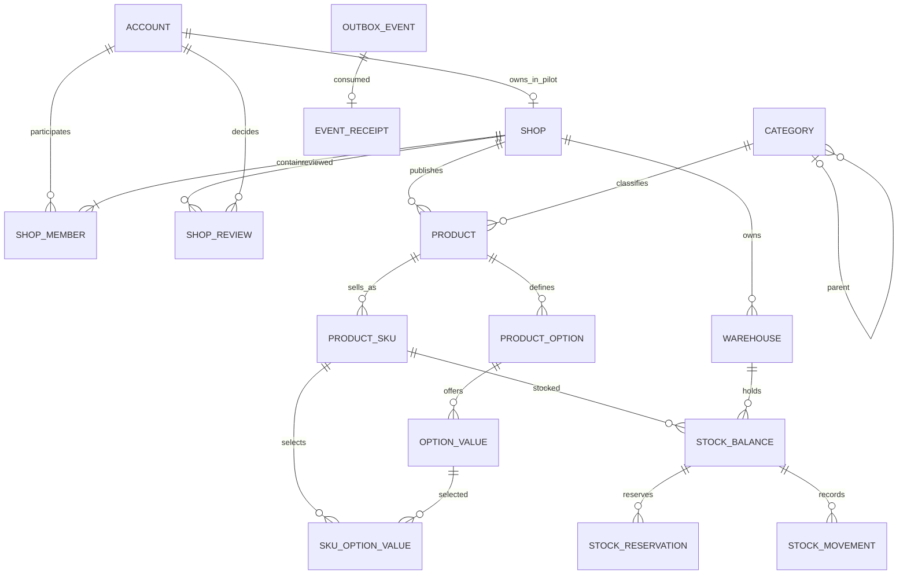

# Thiết kế cơ sở dữ liệu VShop

Ngày cập nhật: **19/11/2026**. PostgreSQL **18**, modular monolith, marketplace Việt Nam.

## 1. Phạm vi và trạng thái

| Phạm vi | Trạng thái | Nguồn kiểm chứng |
|---|---|---|
| Identity, merchant, catalog/SKU, inventory, platform | **17 bảng đã có migration thực** | Flyway V1, V2, V1001, V1002; local có thêm fixture V1000 |
| Checkout, đơn, khuyến mãi, giao nhận, hậu mãi, tiền, hỗ trợ và file | **38 bảng thiết kế tham chiếu** | `target-commerce.sql`, chạy kiểm cấu trúc ở DB riêng |
| Toàn mô hình tham chiếu | **55 bảng, 14 schema, 389 cột** | Dictionary được xuất từ PostgreSQL sau khi thực thi DDL |

`ImplementedSchema` nghĩa là bảng đã được tạo bằng migration, **không đồng nghĩa mọi API/use case của bảng đã được triển khai**. Inventory reservation/movement mới có nền dữ liệu; chưa có command checkout giữ tồn. `ReferenceDesign` chưa được đưa vào DB ứng dụng hoặc dùng để giao dịch tiền thật.

Các file để review:

- [Từ điển cột đầy đủ](data-dictionary.csv): giai đoạn, schema/bảng, thứ tự cột, kiểu, null/default, precision và generated expression.
- [Khóa và ràng buộc](constraints.csv): PK, FK, UNIQUE, CHECK và NOT NULL do PostgreSQL trả về.
- [Index](indexes.csv): tên và biểu thức index.
- [DDL tham chiếu commerce](target-commerce.sql): thiết kế vật lý các module chưa triển khai.
- [Kiểm tra tài chính tham chiếu](target-design-checks.sql): bút toán cân, bất biến và chống trùng.

CSV được sinh từ catalog PostgreSQL, không viết tay danh sách cột rồi giả định trùng với DB.

## 2. Nguyên tắc thiết kế

1. Chuẩn hóa dữ liệu tác nghiệp theo thực thể và quan hệ; loại bỏ giá/tồn khỏi bảng nội dung sản phẩm. Phần lõi hướng tới 3NF; các trường dư thừa dùng để giữ phạm vi tenant có FK ghép bảo vệ.
2. UUID làm khóa nội bộ. Keycloak `sub` là khóa tích hợp, không dùng làm mật khẩu hay khóa chính cho mọi bảng. Bản hiện tại có một issuer được tin cậy; đa issuer phải bổ sung khóa `(issuer, subject)` trước khi hỗ trợ.
3. Giá trị tiền dùng integer VND, không float. Tỷ lệ dùng NUMERIC. Khi thêm API tiền lớn, dùng chuỗi decimal/string hoặc chốt miền số an toàn cho JavaScript; catalog hiện giữ contract number để tương thích UI và dữ liệu mẫu.
4. Thời điểm sự kiện dùng TIMESTAMPTZ, xử lý UTC; ngày nghiệp vụ đối soát dùng DATE khi đúng ý nghĩa. Không dùng timezone máy client làm căn cứ hết hạn.
5. FK, UNIQUE, NOT NULL, CHECK nằm trong DB; guard quyền, transition và invariant tổng nhiều dòng nằm trong service/transaction, hoặc constraint trigger được kiểm chứng.
6. Snapshot đơn/quote/địa chỉ/biểu phí là dữ liệu hợp đồng cố ý lưu tại thời điểm giao dịch. JSONB chỉ dùng cho snapshot hoặc payload có version, không thay thế tất cả quan hệ/khóa.
7. Giữ trạng thái đơn, payment attempt, charge/refund, shipment, return case và payout riêng. Không dùng một enum trạng thái cho mọi nghiệp vụ.
8. Audit và inventory movement phải được ghi bởi use case cùng transaction; finance journal sửa sai bằng reversal. Chính sách lưu giữ/ẩn danh phải xét nghĩa vụ tài chính/tranh chấp, không cascade xóa toàn bộ lịch sử người dùng.

PostgreSQL không tự tạo index ở phía cột tham chiếu FK; index phải được xem xét theo truy vấn và kế hoạch thực thi. Cross-row aggregate không thể được bảo vệ bằng CHECK tham chiếu tùy ý bảng khác. [PostgreSQL constraints](https://www.postgresql.org/docs/18/ddl-constraints.html)

## 3. Mô hình lõi đã triển khai



Shop phải có owner account ở DB; service tạo owner membership cùng transaction. Ký hiệu membership `|{` biểu diễn kỳ vọng use case; FK hiện bảo vệ danh tính OWNER khớp shop nhưng không cưỡng chế mọi shop được tạo bằng SQL thủ công phải có ít nhất một membership.

| Bảng | Ý nghĩa, khóa và bất biến chính |
|---|---|
| `identity.account` | Mapping subject → UUID account, trạng thái domain; không lưu mật khẩu/token |
| `merchant.shop` | Shop và owner; unique owner là **giới hạn pilot một shop/account**, không phải luật marketplace vĩnh viễn |
| `merchant.shop_member` | Quan hệ account–shop và role; OWNER phải trùng owner của shop qua generated column + FK ghép; phân quyền staff chưa mở API |
| `merchant.shop_review` | Quyết định admin, lý do, reviewer và thời điểm; audit cũ không được giả lập thành review mới |
| `catalog.category` | Danh mục có parent; cấm tự làm parent; ngăn chu trình nhiều cấp là trách nhiệm service khi có editor |
| `catalog.product` | Nội dung hàng hóa, shop, ngành, slug, trạng thái, version; không lưu giá/tồn |
| `catalog.product_sku` | Đơn vị bán được; SKU code unique/shop, variant signature unique/product, giá/currency riêng; FK bảo vệ SKU thuộc đúng shop của product |
| `catalog.product_option` | Chiều phân loại của một sản phẩm, như màu/kích cỡ |
| `catalog.option_value` | Giá trị hợp lệ của từng chiều phân loại |
| `catalog.sku_option_value` | Một giá trị/chiều cho SKU; FK ghép không cho gắn option của sản phẩm khác; chữ ký biến thể phải được command service tạo nhất quán |
| `inventory.warehouse` | Kho thuộc shop; dữ liệu chuyển đổi dùng kho DEFAULT, chưa đại diện địa chỉ xuất hàng đã xác minh |
| `inventory.stock_balance` | PK `(sku_id, warehouse_id)`; cùng shop với SKU/kho; `available = on_hand - reserved - blocked >= 0` |
| `inventory.stock_reservation` | Quantity, TTL, state và idempotency key; `reference_id` chờ checkout module có FK; chưa có API giữ tồn |
| `inventory.stock_movement` | Delta và reason theo nghiệp vụ; idempotency key unique; cần hạn chế UPDATE/DELETE của runtime role khi harden production |
| `platform.audit_event` | Actor, action, resource, reason và thời điểm; index phục vụ truy vết actor/resource |
| `platform.outbox_event` | Domain event cùng commit với mutation; có schema version, aggregate và processing marker |
| `platform.event_receipt` | Một receipt/event; worker replay không tạo receipt thứ hai |

Không có cột `available` lưu dư thừa; không cộng tồn bán ngay khi buyer gửi yêu cầu trả hàng. Trạng thái và tổng stock phải được command service cập nhật nguyên tử khi xây inventory write flow.

## 4. Mô hình commerce tham chiếu

| Domain | Bảng | Vai trò |
|---|---|---|
| Policy | `platform.policy_version` | Điều kiện có version/ngày hiệu lực để snapshot/tra cứu |
| Identity/merchant | `identity.address`, `merchant.bank_account` | Địa chỉ, beneficiary mã hóa, xác minh và hold |
| Media | `media.asset`, `catalog.product_media` | File private/public, scan và liên kết sản phẩm |
| Checkout | `cart`, `cart_line`, `quote` | Ý định mua không giữ tồn; quote có hạn và version |
| Sales | `checkout_group`, `seller_order`, `order_line`, `order_adjustment` | Tách đơn theo shop; snapshot SKU/giá/ưu đãi/phí và người tài trợ |
| Promotion | `voucher`, `redemption` | Scope, ngân sách, hold/consume/release; tổng budget phải khóa và tính nguyên tử |
| Fulfillment | `shipment`, `shipment_line`, `shipment_event`, `cod_receivable` | Kiện, dòng hàng, tracking chống trùng; delivered không đồng nghĩa COD đã remitted |
| Aftersales | `return_case`, `return_line`, `case_evidence` | Case theo dòng/quantity; policy, hạn và chứng cứ |
| Payment | `intent`, `attempt`, `charge`, `allocation`, `refund`, `refund_allocation` | Phân biệt ý định, lần thử, tiền thu thật và phân bổ/hoàn; ghi cả charge trùng để tra soát |
| Finance | `ledger_account`, `journal_entry`, `journal_line`, `settlement`, `settlement_line`, `payout`, `reconciliation_batch`, `reconciliation_item` | Sổ cái, phải trả seller, chi và đối soát tách nhau |
| Engagement | `review`, `support_ticket`, `ticket_message` | Đánh giá gắn dòng mua, hỗ trợ có đối tượng/actor |

Trong bảng này tên không kèm schema được hiểu theo domain tương ứng. DDL đầy đủ có namespace và FK cụ thể.

## 5. Quan hệ và cardinality quan trọng

- Buyer 1 → N checkout groups; group 1 → N seller orders; pilot unique `(group, shop)`.
- Seller order 1 → N order lines; composite FK giữ line thuộc đúng shop/SKU.
- Product 1 → N SKU; SKU N ↔ N warehouse qua stock balance; quantity không đặt ở product.
- Intent 1 → N attempts; attempt 1 → N charge records; charge N ↔ N seller order qua allocation. FK ghép giữ allocation cùng checkout group.
- Charge 1 → N refunds; refund N ↔ N allocations, có charge ID chung để ngăn hoàn nhầm charge.
- Shipment và return case liên kết order lines bằng FK ghép để tránh line của order khác.
- Journal entry 1 → N journal lines; currency của line khớp entry và ledger account bằng FK ghép.
- Payout liên kết beneficiary đúng shop và giữ snapshot đích; đổi tài khoản không đổi lệnh chi cũ.

## 6. Invariant phải thực hiện bằng transaction/service

| Invariant | Cách thực hiện khi phát triển use case |
|---|---|
| Không oversell | Khóa balance hoặc conditional UPDATE; tạo reservation/movement/outbox cùng commit; khóa SKU theo thứ tự ổn định |
| Không vượt budget voucher | Giữ quota/ngân sách nguyên tử; hết hạn/rollback nhả đúng một lần |
| Line totals/group totals | Server calculator theo snapshot; kiểm tổng trước commit; không tin tổng từ client |
| Refund không vượt tiền đã thu | Khóa charge/quota hoàn; cả refund pending và completed chiếm hạn mức; không chỉ SUM sau khi gửi PSP |
| Quantity trả không vượt đã mua | Giữ quantity đang có case hoạt động và đã hoàn; không chỉ kiểm từng dòng riêng lẻ |
| Buyer sở hữu order/case/review | Backend kiểm qua checkout buyer; FK account tồn tại không thay thế authorization |
| Shipment quantity không vượt line | Serialize thao tác chia kiện, tổng forward allocations và return allocations theo direction |
| Payout không vượt available | Số dư theo journal và hold/payout-in-flight, đối soát tiền về, reference ổn định khi UNKNOWN |
| Multi-step external PSP/carrier | Intent/outbox, idempotency, query/reconcile và compensation; không coi ACID DB bao trùm HTTP ngoài |

PostgreSQL row lock có hiệu lực trong transaction và deadlock cần retry có giới hạn; phải chốt chiến lược khóa trước khi viết các command này. [Explicit locking](https://www.postgresql.org/docs/18/explicit-locking.html)

## 7. Sổ cái và giới hạn bằng chứng

DDL tham chiếu dùng line debit/credit một phía, currency FK, business event key unique, constraint trigger trì hoãn để kiểm entry có ít nhất hai line và tổng nợ = tổng có khi kết thúc transaction. Trigger chặn UPDATE/DELETE và thêm line vào entry đã commit ở transaction trước.

`target-design-checks.sql` đã thực thi trong DB riêng: ghi entry cân; từ chối entry không cân; từ chối sửa line; từ chối thêm line sau commit; từ chối business event key trùng. Điều này chứng minh các constraint được kiểm, **chưa chứng minh toàn bộ nghiệp vụ finance**. Chưa có PSP adapter, posting rules, recovery, grant runtime role hoặc kiểm đối soát tiền thật.

COD refunds cần rail hoàn phù hợp và nguồn vốn; `payment.refund` trong bản tham chiếu hiện mô tả hoàn trên charge trả trước. Khi triển khai hoàn COD phải thêm refund instruction/rail và chứng từ ngân hàng, không tạo charge PSP giả để ép vào schema. Nghĩa vụ thuế, hóa đơn, chargeback, KYC, fraud holds và appeal vẫn cần chi tiết hóa sau khi có đối tác/policy. Không công bố bản DDL này là schema tài chính đã đủ để vận hành live.

## 8. Migration, dữ liệu cũ và rollback

- Không sửa V1/V2/V1000 đã áp dụng. V1001 chuyển dữ liệu, V1002 tăng ràng buộc và chuẩn hóa tên receipt. Các migration tiếp theo dùng số lớn hơn 1002.
- Vì fixture cũ ở V1000, migration lõi mới tiếp tục V1001; bỏ `out-of-order` local sau khi chuyển đổi. Database trống production bỏ qua fixture local và vẫn áp dụng V1 → V2 → V1001 → V1002.
- V1001 tạo account từ owner subject, tạo SKU từ product, kho mặc định và opening balance/movement; giữ ID sản phẩm, giá, tồn và lịch sử audit/outbox.
- Backup trước thay đổi: `.local/backups/vshop-before-schema-refactor.sql`. Snapshot kiểm tra trước/sau: `.local/backups/before-refactor.json`, `after-refactor.json`.
- Trước khi chạy E2E mới: 5 shop, 6 product, 16 audit và 16 outbox không đổi; checksum `(product_id, price, stock)` trước/sau đều `484220645b8ff9ac13004b145f1379a2`.
- Đây là migration có thay đổi cột, cần dừng writer khi áp dụng và deploy code tương ứng; không rollback chỉ binary cũ. Với production lớn phải dùng expand/migrate/contract qua nhiều release. Nếu thất bại trên local, restore backup vào DB riêng để kiểm tra trước khi đổi kết nối, không tự xóa DB hiện tại.

## 9. Kiểm chứng và tái sinh tài liệu

```powershell
pwsh -File scripts/test-backend.ps1
pwsh -File scripts/verify-db-design.ps1 -ExportDictionary
```

Lệnh thứ hai tạo DB mới tên `vshop_design_review_<timestamp>`, áp dụng DDL lõi và tham chiếu, chạy ledger checks, xuất dictionary/constraints/indexes rồi xóa đúng DB kiểm tra đó. Không chạy DDL tham chiếu vào `vshop` hoặc `vshop_test`. Thêm `-KeepDatabase` nếu cần xem bằng công cụ DB.

Hiện có 11 kiểm thử DB-specific: FK owner, owner membership, một shop/owner pilot, SKU chéo shop, kho chéo shop, số lượng âm/vượt giữ, duplicate SKU/variant, tiền/currency, option chéo sản phẩm, reservation quantity/idempotency và aggregate tồn nhiều SKU/kho. Chúng chạy trên PostgreSQL thật; không dùng H2 thay cho PostgreSQL.

## 10. Vận hành trước production

Runtime role cần tách khỏi migrator, không có quyền tạo/xóa schema hoặc tắt trigger; hạn chế sửa/xóa journal, audit và movement; secrets lấy từ môi trường quản lý. Docker local hiện dùng quyền thuận tiện cho phát triển, chưa đạt mô hình quyền production. Backup/PITR và restore drill phải được kiểm riêng. PII cipher columns cần KMS/key rotation và access policy thực tế, không chỉ đổi tên cột thành `ciphertext` là đã có mã hóa.
